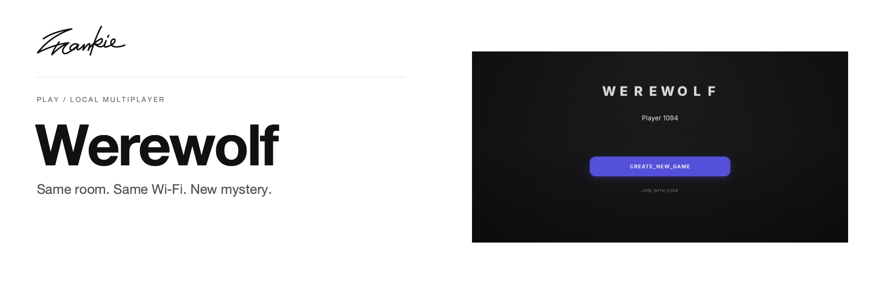

# Werewolf Local

[English](README.md) · [简体中文](README.zh-CN.md)

连上同一个 Wi-Fi，打开房间，让游戏从白天走向黑夜。

[项目指南](docs/guide.md) · [本地运行](#本地运行)

## 可以做什么

- 在电脑上主持房间，通过手机浏览器加入。
- 选择玩家配置，跟随白天与黑夜的游戏流程。
- 使用内置中文法官播报引导整局游戏。

## 本地运行

安装服务端与客户端依赖，然后启动两者：

```sh
npm ci
npm start
```

使用 Vite 输出的前端地址。其他玩家通过同一网络中的主机电脑连接。

## 开始之前

这是局域网游戏。手机需要能够访问主机电脑，React 客户端也需要连接 Socket.IO 服务端。房间与配置细节见项目指南。

## 开发说明

```sh
npm run build --prefix client
```

在本地服务器上检查建房、手机加入以及昼夜流程。

[项目指南](docs/guide.md) · [Banner 维护](docs/readme/README.md)

---

由 [Songhai Fan](https://github.com/SonghaiFan) 制作 · Frankie 系列项目
